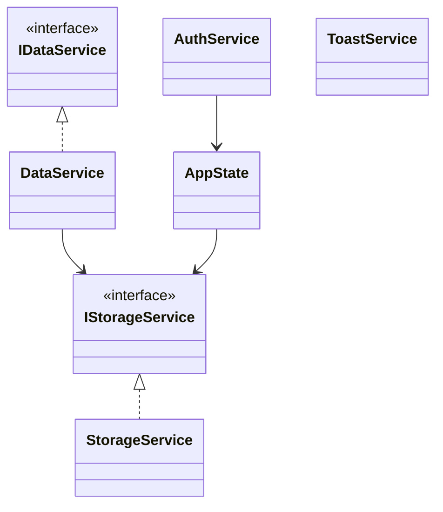

# Afghan Future Hope Platform

A multilingual (English, Dari, Pashto) Blazor WebAssembly platform that connects donors, volunteers and young people with
education, health, scholarship and job opportunities. Built with C# 12 and .NET 8.

## 1. Requirements
- .NET 8 SDK (https://dotnet.microsoft.com/download)
- Chrome, Edge or Firefox

## 2. Run it
```bash
cd AfghanFutureHope
dotnet run
```
Chrome opens at http://localhost:5080. (For hot reload while editing use `dotnet watch`.)

> Blazor WebAssembly needs the .NET build step, so the VS Code "Live Server" extension cannot run it from the source folder.
> To host the finished site on any static server run `dotnet publish -c Release -o publish` and serve `publish/wwwroot`.

## 3. Run the tests
```bash
cd AfghanFutureHope.Tests
dotnet test
```

## 4. Demo accounts
| Role | Username | Password |
|------|----------|----------|
| Administrator | `admin` | `admin123` |
| Student | `student` | `student123` |

## 5. Features
- Home with animated sunrise hero, live impact numbers, featured initiatives, stories
- Initiatives: search, filter, sort, detail page, donation form with validation, live funding bar
- Opportunities: filter by type, application dialog with validation
- Role-based dashboard: admin (chart, add/delete initiatives, gifts, applications), student (own activity)
- Light/dark theme, English/Dari/Pashto with right-to-left layout, saved in the browser
- Toast notifications, global error boundary, skip link, ARIA labels, keyboard focus, reduced-motion support

## 6. Architecture
```
Pages (Razor)  ->  Components (reusable UI)  ->  Services (interfaces)  ->  Browser storage (JS interop)
                       Models (entities + validated form models)
```

Pattern: component-based MVVM-style UI. Razor pages are views, services hold state and logic, models are data.

## 7. Where each rubric criterion lives
| # | Criterion | Where |
|---|-----------|-------|
| 1 | Code structure | `Models/`, `Services/`, `Components/`, `Layout/`, `Pages/`; services behind interfaces, DI in `Program.cs` |
| 2 | Reusability | `StatCard`, `InitiativeCard`, `ProgressBar`, `Modal`, `TemplatedList<TItem>` (parameters + `EventCallback`) |
| 3, 7 | Cross-platform, responsive | `wwwroot/css/app.css` grid, flexbox, 900px and 640px media queries, mobile menu |
| 4 | State management | `AppState` container, `CascadingValue` from `MainLayout`, `Changed` events |
| 5, 6 | UI and UX | lapis, saffron and pomegranate palette from Afghan crafts; sticky nav, skip link, empty states |
| 8 | Core functionality | Pages for browsing, donating, applying, signing in, managing |
| 9 | Advanced features | Role-based access, 3 languages with RTL, dark mode, data persistence |
| 10 | Error handling | `ErrorBoundary`, try/catch in services and storage, `ValidationSummary`, toasts |
| 11, 13 | Efficiency, resources | WebAssembly, cached init task, no heavy libraries, CSS-only chart |
| 12 | Scalability | `IDataService` can be replaced by an HttpClient/API implementation |
| 14 | Testing | `AfghanFutureHope.Tests` (xUnit + bUnit) |
| 15 | QA | Checklist below |
| 16 | Documentation | This README plus XML comments in code |
| 17, 18 | Innovation, creative .NET | Templated component, localizer with RTL, error boundary, JS interop bridge |
| 19, 20 | Professionalism, presentation | See outline below |

## 8. Manual QA checklist
- [ ] Chrome, Edge, Firefox, Safari: all pages load
- [ ] Phone (360px), tablet (768px), desktop (1440px): no sideways scrolling
- [ ] Switch to Dari: layout flips right-to-left; switch back to English
- [ ] Dark mode on and off; refresh keeps the choice
- [ ] Submit each form empty, then with bad data, then with good data
- [ ] Admin: add and delete an initiative; student: see own gifts and applications
- [ ] Keyboard only: Tab through the menu, a form and the Apply dialog

## 9. Presentation outline (15 to 20 minutes)
1. Team, topic, aim, goals, plan
2. Analysis of existing technologies (Blazor vs React vs Angular) and comparison
3. Architecture and diagrams (above)
4. Relevance: why Afghan students and donors need transparent opportunities
5. Methodology and screens (mockups)
6. Live demo: home, donate, apply, dashboard, Dari mode, dark mode
7. Tests, challenges, future work (real API, Identity, payments)
